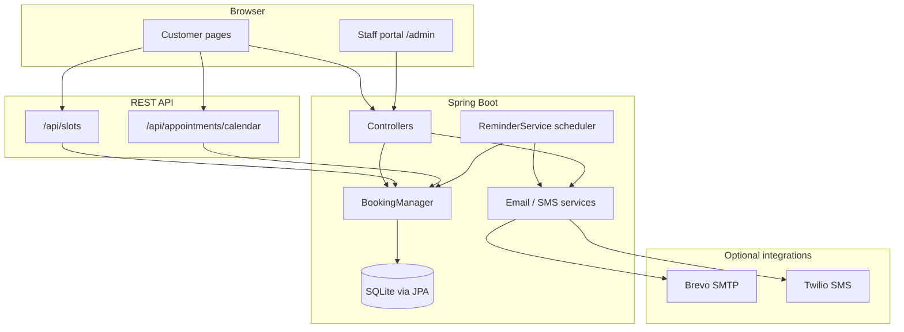
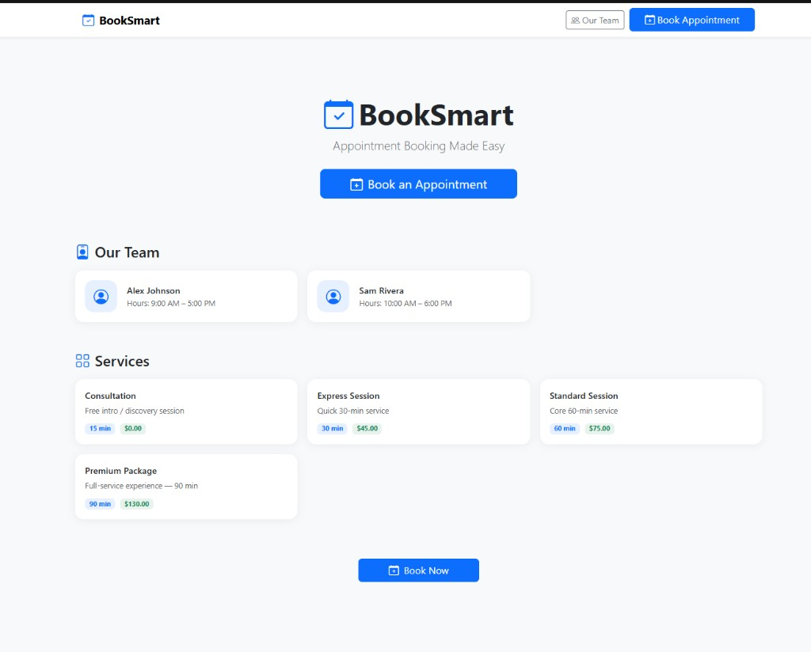
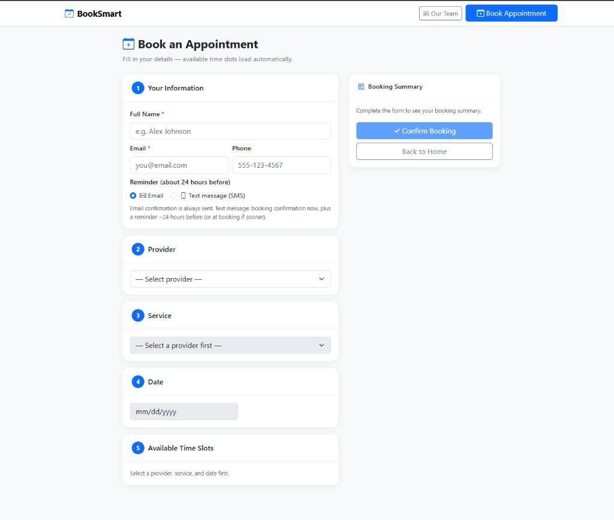
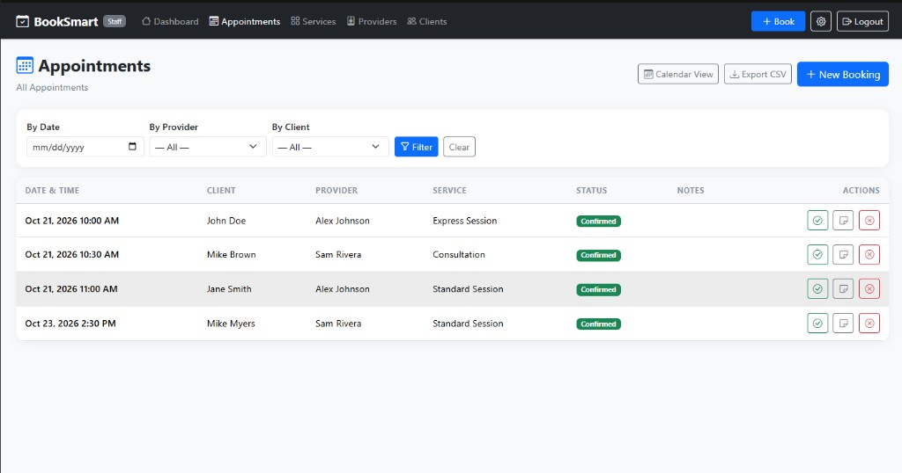
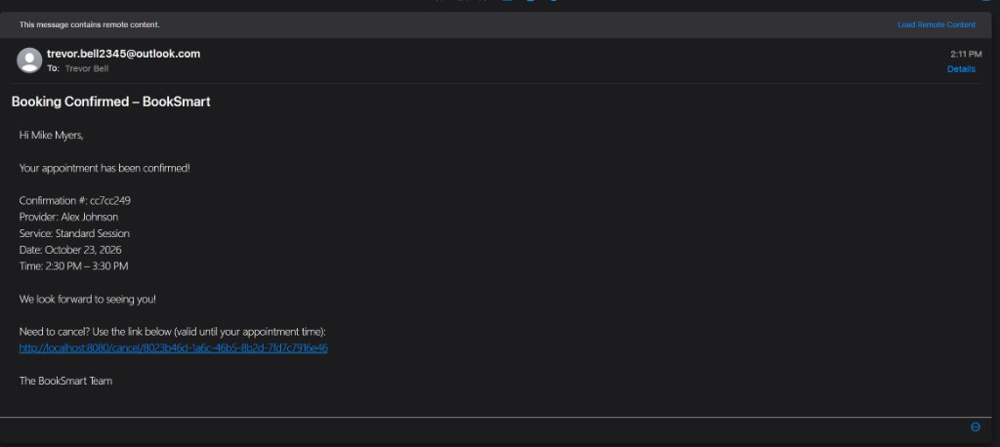

# BookSmart — Appointment Booking System

A self-hosted appointment booking platform for small businesses: customers book online, staff manage operations in a PIN-protected portal, and the system handles confirmations, reminders, and self-service cancellation.

**Repository:** [github.com/trevorb-mcleod/Booking-System](https://github.com/trevorb-mcleod/Booking-System)


## Resume highlights

Use or adapt these on a resume or LinkedIn project blurb:

- Built **BookSmart**, a full-stack appointment platform (Spring Boot 3, Thymeleaf, SQLite) with customer booking and a PIN-protected staff portal.
- Implemented **conflict-aware scheduling**, live slot APIs, “any available provider” assignment, and **AND-style appointment filters** for admin.
- Delivered **token-based self-service cancellation** (no customer login) plus confirmation email, `.ics` export, and optional **SMS/email reminders** (Brevo, Twilio).
- Integrated **external services** behind configuration flags; added **JUnit 5** integration tests and **GitHub Actions CI** (`mvn test` on push).

## Architecture

Server-rendered monolith: HTML from Thymeleaf, JSON APIs for dynamic booking UI, scheduled reminders, and optional third-party messaging.



| Path | Role |
|------|------|
| `CustomerController`, templates under `customer/` | Public booking and cancel-by-token |
| `AppointmentController`, `DashboardController`, … | Admin CRUD, calendar, export |
| `ApiController` | Slot availability and calendar JSON for the booking wizard |
| `BookingManager` | Domain logic: conflicts, filters, persistence |
| `EmailService` / `SmsService` / `AppointmentNotificationService` | Confirmations, reminders, channel preference |

## Screenshots

### Customer experience

| Home | Booking |
|:---:|:---:|
|  |  |

### Staff portal

| Appointments |
|:---:|
|  |

### Notifications

| Booking confirmation email |
|:---:|
|  |

## Features

### Customer-facing
- Public home and team pages with provider/service discovery
- Multi-step booking: provider (or **Any Available**), service, date, live slot picker (REST-backed)
- Email booking confirmation with **one-click cancel link** (token-based, no account required)
- **Email or SMS** reminder preference (~24h before, with short-notice handling for same-day bookings)
- Confirmation page and **`.ics` calendar download**

### Staff portal (`/admin`)
- PIN-protected dashboard, services, providers, clients, appointments
- Admin booking flow, appointment **calendar view**, **CSV export**
- **Combined filters** on appointments (date + provider + client, AND logic)
- Per-appointment notes, complete/cancel actions

### Platform
- **Spring Boot 3** monolith — server-rendered UI (Thymeleaf) + JSON APIs for slots/calendar
- **SQLite** persistence (zero external DB for local/small deploys)
- **Brevo SMTP** (or any SMTP) for transactional email
- **Twilio** optional SMS (trial-friendly template mode + custom messages after account upgrade)
- Scheduled reminder job (`@Scheduled`)

## Tech stack

| Layer | Choice |
|--------|--------|
| Runtime | Java 21+, Spring Boot 3.4 |
| UI | Thymeleaf, Bootstrap 5 |
| Data | Spring Data JPA, SQLite |
| Integrations | Spring Mail, Twilio REST (SMS) |

## Quick start

### 1. Configure

```bash
cp src/main/resources/application.properties.example \
   src/main/resources/application.properties
```

Edit `application.properties` (see example file for email, SMS, branding, admin PIN).

### 2. Test

```bash
mvn test
```

Uses an in-memory SQLite database and the `test` profile (demo seed data disabled). Coverage includes `BookingManager` integration tests, `@WebMvcTest` for customer `/book` and `/cancel/{token}`, and unit tests for email/SMS/notification services (mocked SMTP and Twilio).

### 3. Run

**macOS / Linux:**

```bash
./start.sh
```

**Windows:**

```powershell
mvn spring-boot:run
```

App default: **http://localhost:8080**

| URL | Description |
|-----|-------------|
| `/` | Customer home |
| `/book` | Booking form |
| `/admin` | Staff portal (PIN) |

### 4. Staff setup

1. Open `/admin` and enter your PIN
2. Add **Services** (duration, price)
3. Add **Providers**, assign services and working hours

## Email (Brevo)

1. Sign up at [brevo.com](https://brevo.com)
2. Verify a sender under **Senders**
3. Create an **SMTP key** under **SMTP & API**
4. Set `spring.mail.*` and `booking.reminders.from` in `application.properties`

## SMS (Twilio, optional)

1. Twilio Console → assign trial or purchased **From** number (`twilio.from-number`)
2. Set Account SID + API key (or Auth Token) in `application.properties`
3. `booking.sms.enabled=true`
4. **Trial:** `booking.sms.trial-mode=true` (Twilio predefined template; sample date/time in body)
5. **Upgraded account:** `booking.sms.trial-mode=false` for custom message text

Verify recipient numbers on trial accounts. Set `booking.base-url` to your public URL so cancel links work in email/SMS.

## Live demo (Render)

Deploy with **Docker + environment variables only** — no keys in the repo.

| Artifact | Purpose |
|----------|---------|
| `Dockerfile` | Production image (excludes `application.properties`) |
| `render.yaml` | Render Blueprint; secrets use `sync: false` (set in dashboard) |
| `application-prod.properties` | Non-secret defaults; `${ENV}` placeholders |
| `.env.example` | Local Docker reference — copy to `.env` (gitignored) |

**Full walkthrough:** [docs/deploy-render.md](docs/deploy-render.md)

Minimum env vars for a public demo:

- `BOOKING_BASE_URL` — your `https://….onrender.com` URL  
- `BOOKING_ADMIN_PIN` — strong PIN (not the example/dev default)  
- Leave `BOOKING_EMAIL_ENABLED` / `BOOKING_SMS_ENABLED` at `false` until SMTP/Twilio vars are set in Render  

On `prod` startup, `ProdStartupChecks` refuses weak PINs, `localhost` base URLs, and half-configured email/SMS so misconfigured deploys fail before going live.

Health check: `/actuator/health`

## Deployment notes

- `booking.db` is created in the working directory — back it up regularly
- Do not commit `application.properties`, `.env`, or `booking.db` (gitignored)
- Use a public `booking.base-url` in production (env: `BOOKING_BASE_URL`)

## Room for improvement

The core booking loop is implemented end-to-end; the items below are deliberate next steps that would strengthen the project for **production use** and **portfolio visibility** (resume, interviews, recruiters).

### High impact for recruiters (recommended order)

1. ~~**CI pipeline**~~ — GitHub Actions + README badge (done).
2. ~~**README polish**~~ — Architecture diagram, resume highlights, and screenshots under `docs/screenshots/` (done).
3. ~~**More tests**~~ — `@WebMvcTest` for booking/cancel; notification services with mocked SMTP/Twilio (done).
4. ~~**Live demo**~~ — Docker + Render Blueprint + env-only secrets ([deploy-render.md](docs/deploy-render.md)).
5. **PostgreSQL profile** — Spring profile `prod` with Postgres while keeping SQLite for dev.

### Product & UX

- **Custom SMS on upgraded Twilio** — Branded copy with real appointment time and cancel link (already wired when `trial-mode=false`).
- **Admin analytics** — Dashboard charts: revenue by month, bookings by service/provider, utilization.
- **Stripe deposits** — Pay at booking or hold card on file; tie payment status to appointment state.
- **Customer accounts** — Optional login to view upcoming/past appointments (OAuth or magic link).
- **Waitlist** — Notify when a slot opens after cancellation.
- **Multi-location** — Locations → providers → hours; filter booking by location.
- **Calendar sync** — Provider Google/Outlook two-way sync for external calendars.
- **i18n / accessibility** — Locale bundles, ARIA and keyboard flows on booking wizard.

### Engineering hardening

- **Database migrations** — Flyway/Liquibase instead of relying on `ddl-auto` + SQLite patcher for schema drift.
- **Admin auth** — Replace single PIN with hashed credentials, lockout, or SSO for multi-user shops.
- **Rate limiting & abuse** — Throttle public `/book` and `/cancel/{token}`; CAPTCHA on booking if exposed to the internet.
- **Observability** — Structured logging, health/readiness endpoints, optional metrics (Micrometer).
- **API documentation** — OpenAPI for `/api/*` if you add mobile or SPA clients later.
- **Docker** — `Dockerfile` + compose (app + optional Postgres) for one-command demos.

### Already in place (worth calling out on a resume)

- Token-based self-service cancellation without customer accounts
- Conflict-aware scheduling and “Any Available Provider” slot merging
- Multi-channel notifications (email + optional SMS) with scheduled reminders
- Staff CRUD, calendar view, CSV export, and composable appointment filters
- External integrations (SMTP, Twilio) behind feature flags and config

---

*BookSmart is designed to stay maintainable: add features that match a real business story on your resume rather than listing every possible SaaS checkbox.*
